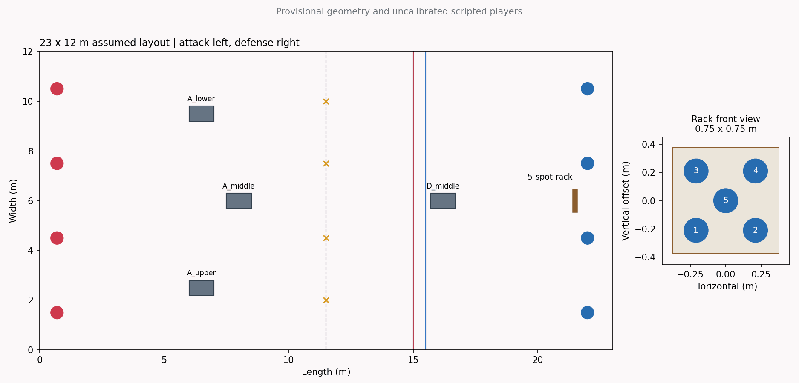
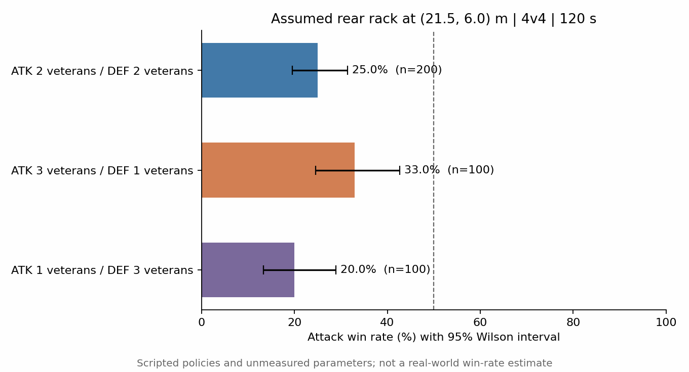
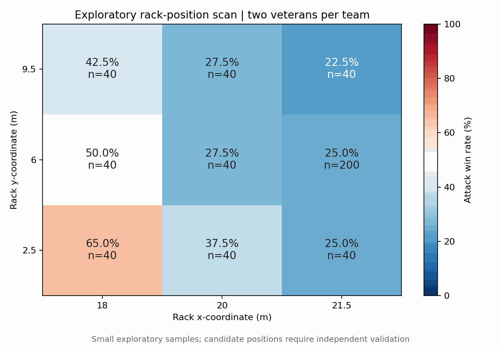
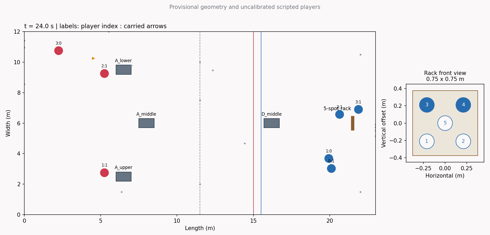
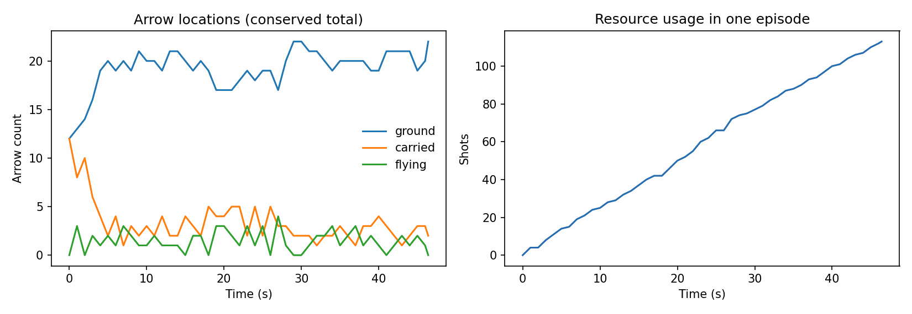

# 首轮攻防仿真：23×12 米

这是 **1020 局脚本对局**的条件性结果。没有真人校准，没有训练 RL 策略；统计区间只描述当前模型的 Monte Carlo 不确定性。

## 已知尺寸与假设

- 用户给定：场地23×12米；同一块靶架正面0.75×0.75米，五孔相对位置固定。
- 掩体原始输入有歧义，暂按1×0.6×1米解释。草图坐标不是实测：攻方掩体(6.5,2.5)、(8,6)、(6.5,9.5)，守方掩体(16.2,6)。
- 默认靶架中心(21.5,6,1.1)米，面朝攻方；孔直径17厘米、中心偏移与安装高度均是假设。
- 4v4，120秒；攻方持弓无箭，中场共4支，每人首次最多领取1支；守方每人配给5支，携带3支、出生区留下2支。
- 攻方无限复活，守方每人2条命；复活等待3秒且不补箭；接箭关闭，清完五孔才算攻方胜；超时守方胜。
- 暂定攻方移动至x=15米，守方从x=15.5米开始；新攻防模式取箭后不要求回到底线。
- 新手eta范围[0.15,0.45]，老手[0.65,0.95]；角度误差、瞄准/搭箭速度按eta映射。跑速3m/s，箭速25m/s，均未实测。
- 脚本：攻方三人优先清靶、一人优先压制，守方攻击可见敌人。脚本仅使用局部观测及公开地图，不使用敌人eta或隐藏位置。

完整参数见 [配置](../../configs/attack_defense_23x12.json)。



## 默认后场靶位：阵容对比

| 阵容：攻方老手 / 守方老手 | 局数 | 攻方胜率 | 95% Wilson 区间 | 平均局长 | 平均剩余靶点 |
| --- | ---: | ---: | --- | ---: | ---: |
| 2 / 2 | 200 | 25.0% | 19.5%–31.4% | 107.3 秒 | 1.89 |
| 3 / 1 | 100 | 33.0% | 24.6%–42.7% | 96.9 秒 | 1.41 |
| 1 / 3 | 100 | 20.0% | 13.3%–28.9% | 110.9 秒 | 2.10 |



这些条件必须分别看，不能将不同阵容汇总成50%就宣称公平。老手增加与策略选择同时影响结果；不能把该表外推到所有战术或真人水平。

## 靶架位置扫描

仅改变靶架平面坐标，五孔内部布局、场地、能力分布和其他规则保持一致。守方脚本的驻守点会根据公开靶位调整，因此结果包含守方的固定适应规则，而不是完全冻结的站位。

| 靶架坐标 (x,y)，米 | 局数 | 攻方胜率 | 95%区间 |
| --- | ---: | ---: | --- |
| (21.5, 6) | 200 | 25.0% | 19.5%–31.4% |
| (18, 2.5) | 40 | 65.0% | 49.5%–77.9% |
| (18, 6) | 40 | 50.0% | 35.2%–64.8% |
| (18, 9.5) | 40 | 42.5% | 28.5%–57.8% |
| (20, 2.5) | 40 | 37.5% | 24.2%–53.0% |
| (20, 6) | 40 | 27.5% | 16.1%–42.8% |
| (20, 9.5) | 40 | 27.5% | 16.1%–42.8% |
| (21.5, 2.5) | 40 | 25.0% | 14.2%–40.2% |
| (21.5, 9.5) | 40 | 22.5% | 12.3%–37.5% |



这是探索性扫描，不是已验证的最优位置。大部分格子仅40局，且多个位置复用了种子；不能把格子当作相互独立样本，也不能仅凭最接近50%的格子判定平衡。

## 候选靶位的独立验证

候选靶位(18,6)米使用独立种子10000–10199验证：106/200局攻方获胜，即 **53.0%**，95%区间 **46.1%–59.8%**。这些种子未用于选择靶位；结果仍只针对当前脚本与未校准参数，不证明现实平衡，也不保证整个区间落入45%–55%。

## 数值和假设敏感性

| 敏感性条件 | 局数 | 攻方胜率 | 95%区间 |
| --- | ---: | ---: | --- |
| time_step_0.1_check | 20 | 20.0% | 8.1%–41.6% |
| time_step_0.05_check | 20 | 35.0% | 18.1%–56.7% |
| spot_radius_0.065 | 20 | 0.0% | 0.0%–16.1% |
| spot_radius_0.11 | 20 | 45.0% | 25.8%–65.8% |
| all_attackers_clear_targets | 20 | 30.0% | 14.5%–51.9% |

敏感性条件使用相同的独立种子区间5000起；每项样本小，只能发现明显风险，不能证明步长已收敛或参数不重要。0.05秒步长仍用0.3秒策略决策间隔。曲线与碰撞在短时间段内以扫掠线段近似，不能取代真实弹道校准。

## 单局示例与资源

示例使用首个主实验种子1000，而非筛选最佳局。曲线记录地面、携带、飞行箭数与累计射击；每支箭保持唯一ID，总数始终24。没有完成的回合清靶时间保持为空，不将120秒当作实际清靶时间。





掩体利用率是每秒采样、存在敌人时至少一条敌我身体视线被挡的玩家时间比例，只是代理指标。当前低掩体和脚本前压行为可能导致利用率很低，不代表真人掩体无用。

## 复现

```bash
PYTHONPATH=src python -m unittest discover -s tests -v
PYTHONPATH=src python scripts/run_initial_experiments.py
PYTHONPATH=src python scripts/build_initial_report.py
```

Colab入口：[01_attack_defense.ipynb](../../notebooks/01_attack_defense.ipynb)。默认20局/阵容用于快速试跑，可增加样本。

模型源文件SHA256：`831330e1d70568d8013ce7b94cdcd8e3a9a7954e39a3bea90404c6e1d647debb`。配置快照、各条件差异、种子和统计量见 [summary.json](summary.json)。原始回合日志在运行输出目录，默认不纳入Git。

## 下一步

先确认掩体实际长宽高、五孔直径、区域界线、复活耗时与是否保留全歼胜利；再测量箭速和不同熟练度的散布。选定候选靶位后，用新种子与不同攻守策略验证，然后再研究弹药/生命/复活补偿。
